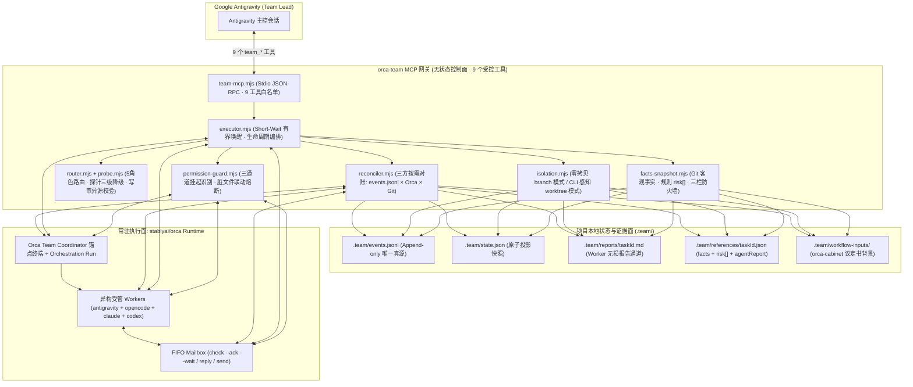

# `orca-team`：基于 `stablyai/orca` 的 Antigravity 受控工程团队协同网关设计方案（`v0.1` 初稿 · 待内阁审议）

> **文档状态**：`v0.1` 初稿（待提交本机 `orca-cabinet` 异构内阁审议）  
> **对标前身**：`Git-Yi-Zhou/paseo-team`（借鉴 `waikoeng234/Nodo` 确定性编排理念与三栏上下文防火墙）  
> **协同生态**：与本机 `orca-cabinet`（异构多模型内阁议事插件）组成**「前店（内阁议事定策）+ 后厂（工程团队施工）」**双插件闭环  
> **技术栈约束**：Node.js `>= 20` 纯内置模块（零外部 npm 依赖），基于 `orca` CLI（Supervised Orchestration + Worktree/Terminal 原语）与本地 Git 构建

---

## 1. 背景与问题定义

在当前 Google Antigravity + `stablyai/orca` 的研发体系中：
- **决策轨（`orca-cabinet`）**：已针对高选错代价的架构、研究与技术选型场景，建立了「组阁前钉扎确认 → 跨家族冷启动立论 → 隔离分支实证核验（`worktree-verify`）→ 交叉质询 → `protocol.json` (v2) 机器对账归档」的严密闭环。
- **执行轨（日常研发与决议落地）**：目前直接暴露基础层 `orca` MCP 的 **15 个底层细粒度工具**（`orca_status`、`orca_repo_list`、`orca_worktree_list`、`orca_worktree_create`、`orca_worktree_manage`、`orca_agent_launch`、`orca_terminal_list/read/send/manage`、`orca_orchestration_run/task/worker/mail`、`orca_cli`）。

### 1.1 直接裸调底层 `orca` 工具的五大工程痛点
1. **主控选型非确定性与同源盲区**：Antigravity 主控每次派活都需临时决定用哪个 `agent`（`antigravity` / `opencode` / `claude` / `codex`）、传什么 `--model` 与 `--effort`，且缺乏强制机制防止「写代码的模型」与「审代码的模型」同属一个模型家族（同源互审导致系统性盲区复现）。
2. **CLI 参数异构踩坑**：Orca 下不同 CLI 的参数约束高度异构——例如 `antigravity`/`claude`/`codex` 支持 `--model` + `--effort` 且支持 `--worktree=new-child`；而 **`opencode` 仅在「既有 Worktree」上支持 `--model <provider/model>`，不支持 `--effort`，若在 `new-child` 上传 `--model` 会直接报错**。让主控每次靠记忆规避这些底层陷阱极易出错。
3. **主控上下文污染与「被审查者自守防火墙」悖论**：直接调 `orca_terminal_read` 或 `worker-read` 会将成百上千行终端噪音灌入主控上下文；而若只读 `worker_done` 邮件里的三句话自述，又等于让被审查的子 Agent 自己把守质量门禁，极易出现“报喜不报忧”、漏报未跟踪垃圾文件或隐瞒越界改动。
4. **Windows 工作树依赖缺失 vs 主分支脏改踩踏**：盲目为每个写任务新建 `git worktree` 会导致新目录缺少 `node_modules` / `.venv`，`tester` 跑不动单测；但若直接在主目录裸跑写任务，又会污染当前主分支且在并发时引发 Git 索引锁冲突。
5. **内阁决议与工程施工断层**：`orca-cabinet` 结案产出的 `.cabinet/runs/<runKey>/protocol.json`（含结构化 `decisions[]` 与 `actions[]`）缺少一键转化为受控施工队列的承接器。

---

## 2. 核心设计理念（继承 `paseo-team` 六大防线 + 原生适配 Orca 执行底座）

1. **5 大专职角色确定性路由 + 探针三级自动降级 + 写审异源对冲（`router.mjs` + `probe.mjs`）**
   - 主控调用 `team_delegate` 时仅声明 `type`（`architecture` / `feature` / `bugfix` / `refactor` / `review` / `test`）与 `hard`（`false` / `true`），严禁主控手填模型名。
   - 复用 `orca-cabinet` 验证成熟的本机 CLI 探针（5 分钟 TTL 缓存探测 `orca status`、`orca account list`、`agy`、`opencode auth list`、`claude`、`codex` 登录态），支持 **`primary → fallback1 → fallback2` 三级自动降级**，并在返回信封显式标注 `degradedFrom`。
   - **写审异源铁律（新增）**：`reviewer` 席位路由时自动校验目标分支/前序写任务的 `providerFamily`，确保审查模型家族与编码模型家族严格异源（如 `coder` 走 `zhipu` / `anthropic` 时，`reviewer` 强制路由至 `deepseek` / `qwen`）。
2. **无状态 MCP 网关 + `.team/events.jsonl` 单一真源 + 入口按需三方对账（`reconciler.mjs`）**
   - **零新增后台守护进程**：完全依托常驻的 Orca Runtime（Coordinator 终端锚点 + Orchestration Run + 持久化 FIFO Mailbox）托管长时 Worker 生命周期。
   - 网关自身保持无状态，以 `.team/events.jsonl`（append-only）记录 `taskId ↔ dispatchId / orcaTaskId / worktreeRef / baseSha / idempotencyKey` 归属关系；每次工具调用入口自动执行 `reconcileWorkspace()`，比对 `events.jsonl × Orca (check + worker-show) × Git (team/* 分支)`，原子投影生成 `.team/state.json`。
3. **客观 Git 事实驱动的三栏上下文防火墙 + 三级无损报告回收（`facts-snapshot.mjs`）**
   - Worker 结束运行后，网关在宿主机直接执行 `git diff --stat <baseSha>` 与 `git status --porcelain`（排除 `.team/` 与 `.cabinet/` 元数据），生成 `.team/references/<taskId>.json`：
     - **`facts`（第一栏·客观事实）**：真实改动文件列表 `changedFiles`、未跟踪残留 `untrackedFiles`、`diffStat`、高危敏感改动文件 `highRiskModifiedFiles`、审批交互记录；
     - **`risk[]`（第二栏·零 Token 确定性风险标签）**：`HIGH_RISK_FILE_MODIFIED`、`UNTRACKED_ARTIFACTS_LEFT`、`NO_EFFECTIVE_DIFF`、`READONLY_ROLE_DIRTIED_TREE`、`WORKER_EXIT_WITH_ERROR` 等；
     - **`agentReport`（第三栏·主观自述附录）**：强制打标 `trustLevel: "untrusted-self-report"`。借鉴 `orca-cabinet` 经验，采用**三级无损提取优先级**：① Worker 写入的 `.team/reports/<taskId>.md` 文件 → ② `orca orchestration worker-read --source=auto` 转录正文 → ③ `worker_done` 邮件正文。
   - 默认仅向 Antigravity 主控返回 `< 500 Tokens` 的 `compactSummary`（含 `facts`、`risk[]` 与 `referencePath`），按需通过 `team_inspect` 深钻全量 Diff。
4. **适配 Orca 原语的三通道审批与脏文件联动熔断（`permission-guard.mjs`）**
   - 针对 Orca 与 Paseo ACP 的底层差异，`reconciler.mjs` 统一收拢 Orca 的三类挂起信号并翻转为 `AWAITING_APPROVAL`：
     1. **Run 邮箱提问/升级**：收到 `type` 为 `question`、`escalation` 或 `decision_gate` 的消息；
     2. **Decision Gate 阻塞**：关联 Orca Task 存在未决 `gate`；
     3. **终端交互挂起探针**：`orca orchestration worker-show` 报告 `observation.agentWait !== null`（Worker 停在终端权限确认提示符上，辅以 `orca terminal read` 抓取上下文）。
   - **脏文件联动熔断与反盲批硬护栏**：
     - 每次 `team_approve(decision: "allow")` 执行前，以及每次 `team_merge(action: "merge")` 合入前，实时扫描相对于 `baseSha` 的高危敏感文件变更（`package.json`、lockfile、`.npmrc`、`.git/`、`.github/`、`.env*`、构建脚本配置）；
     - 若存在高危文件改动，必须显式传入 `acknowledgeHighRiskDiff: true`（审批阶段）或 `acknowledgeRisks: true`（合入阶段），否则网关硬性拦截并返回高危文件列表，阻断“篡改 `package.json` scripts 后诱导执行测试命令”的供应链注入链。
5. **CLI 感知的双模自适应 Git 隔离（`isolation.mjs`）**
   - **模式 A（默认单写任务：`branch` 零拷贝切分支）**：
     - 前置强校验主工作区 `git status --porcelain` 干净（忽略 `.team/`、`.cabinet/`）且无其他在途 `branch` 写任务（`TEAM_SERIAL_WRITE_LOCK`）；
     - 记录 `baseSha` 与 `baseBranch`，在主工作区执行 `git checkout -b team/<taskId>`；
     - 在主工作区对应的既有 Orca Worktree（`id:<repoId>::<root>`）上调用 `orca orchestration worker-start`——**既 100% 零拷贝复用主目录 `node_modules` / `.venv` 供 `coder` 与 `tester` 秒跑测试，又满足 `opencode` 在既有 Worktree 上传 `--model` 的硬性要求**。
   - **模式 B（`team_delegate_batch` 多写任务并发：`worktree` 物理隔离）**：
     - 若路由到的 CLI 原生支持 `new-child` 模型选择（如 `antigravity` / `claude` / `codex`）：直接传 `--worktree=new-child --name=team-<taskId> --setup=skip` 交由 Orca 创建受管子工作树；
     - 若路由到的 CLI 为 `opencode`（需既有 Worktree 才能传 `--model`）：网关先执行 `git worktree add -b team/<taskId> .team/worktrees/<taskId> <baseSha>`，调用 `orca repo set --external-worktree-visibility=show` 与 `orca worktree list` 获取既有 `id:<repoId>::<wtPath>`，再带 `--model` 启动 Worker；
     - 在 `team_merge`（合入或 `discard`）及 `team_interrupt(discardBranch: true)` 时，统一调用 `orca worktree rm --force` + `git branch -D` 彻底回收，零残留面板。
6. **Short-Wait 有界等待控制器 + 直通 `orca-cabinet` 议定书（`executor.mjs`）**
   - `team_delegate` / `team_delegate_batch` / `team_board` / `team_steer` 均支持有界 `waitSeconds`（默认 `20s`，上限 `55s`，底层复用 `orca orchestration check --wait --timeout-ms` 实现事件驱动秒级唤醒，绝不触碰 Antigravity `180s` MCP 硬超时）。
   - `team_from_protocol` 原生支持读取 `.cabinet/runs/<runKey>/protocol.json`（若不传 `cabinetSessionId` 或传 `"latest"`，自动解析 `.cabinet/index.jsonl` 最后一条结案记录；同时向下兼容 `.cabinet/<id>/protocol.json`），强制校验 `schemaVersion === 2` 后生成 `.team/workflow-inputs/protocol-<runKey>.md` 与结构化待派发草案。

---

## 3. 系统总体架构与目录规划



### 3.1 插件目录结构规划（对齐 `orca-cabinet` 工程规范）

```text
orca-team/
├── plugin.json                  # Antigravity 插件清单（严格遵循官方白名单字段）
├── mcp_config.json              # 插件级 MCP 服务器声明（"team" -> ./server/team-mcp.mjs）
├── hooks.json                   # PreToolUse 极速守卫（仅当存在在途 branch 写任务时拦截误切分支/裸建冲突 worktree）
├── package.json                 # verify / smoke / audit / link-plugin / unlink-plugin 脚本
├── assets/
│   └── logo.svg                 # 插件矢量图标
├── config/
│   └── team-roles.json          # 5 大角色跨 CLI 异构钉扎、三级降级链、CLI 能力表与高危文件规则
├── rules/
│   └── AGENTS.md                # Team Lead 四大协同铁律
├── skills/
│   └── team-workflow/SKILL.md   # 日常研发闭环 + orca-cabinet 议定书落地 SOP
├── server/
│   ├── team-mcp.mjs             # 零依赖 Stdio MCP 服务器（支持 newline 与 Content-Length 双帧）
│   └── lib/
│       ├── orca-exec.mjs        # Orca CLI 封装、Team Coordinator 锚点与 Worktree 托管回收
│       ├── probe.mjs            # 本机 CLI 登录态与额度探针（5min 缓存）
│       ├── router.mjs           # (type, hard) 确定性路由、三级自动降级与写审异源避让引擎
│       ├── isolation.mjs        # 零拷贝 branch + CLI 感知 worktree 双模隔离与防漂移合入
│       ├── facts-snapshot.mjs   # Git 客观事实采集、risk[] 规则计算器与三级无损报告提取
│       ├── permission-guard.mjs # Mail/Gate/agentWait 三通道挂起解析与高危文件联动熔断
│       ├── reconciler.mjs       # events.jsonl × Orca × Git 按需三方对账与原子投影
│       └── executor.mjs         # 9 大工具核心处理器与 Short-Wait 唤醒循环
├── scripts/
│   ├── link-plugin.mjs          # Windows Junction / Symlink 挂载至 ~/.gemini/config/plugins/orca-team
│   ├── hook-guard.mjs           # <2ms 快速路径分支保护守卫
│   └── audit.mjs                # 离线 .team/ 账本完整性与残留孤儿分支审计 CLI
└── tests/
    ├── verify.mjs               # 静态结构、JSON Schema 与路由表自洽门禁
    └── smoke.mjs                # 可控 Mock Orca + 真实临时 Git 仓库端到端与故障注入冒烟测试
```

---

## 4. 5 大工程角色跨 CLI 异构路由与 9 工具契约设计

### 4.1 5 大角色默认异构钉扎与三级降级链（`config/team-roles.json`）

复用本机已验证可用的 `antigravity` + `opencode`（`alibaba-token-plan-cn`）模型池，兼顾**能力匹配、额度经济性与写审跨家族异源对冲**：

| 角色 ID (`roleId`) | 职责边界与模式 | 首选路由 (`primary`) | 一级降级 (`fallback1`) | 二级降级 (`fallback2`) | 默认隔离 |
| :--- | :--- | :--- | :--- | :--- | :--- |
| **`architect`** | 架构设计、模块边界、接口契约推演（**只读**） | `opencode` / `alibaba-token-plan-cn/qwen3.8-max` (`qwen`) | `antigravity` / `claude-opus-5-5-high` (`effort=high`, `anthropic`) | `opencode` / `alibaba-token-plan-cn/deepseek-v4-pro` (`deepseek`) | `none`（只读可并发） |
| **`coder-fast`** | 常规功能实现、脚手架、普通缺陷修复（**受控写**） | `opencode` / `alibaba-token-plan-cn/glm-5.3` (`zhipu`) | `antigravity` / `claude-sonnet-5-5-high` (`effort=high`, `anthropic`) | `opencode` / `alibaba-token-plan-cn/kimi-k2.7-code` (`moonshot`) | `branch`（零拷贝 `team/<id>`） |
| **`coder-pro`** | 核心算法攻坚、复杂状态机重构、疑难 Bug（**受控写**） | `antigravity` / `claude-opus-5-5-high` (`effort=high`, `anthropic`) | `opencode` / `alibaba-token-plan-cn/qwen3.8-max` (`qwen`) | `opencode` / `alibaba-token-plan-cn/glm-5.3` (`zhipu`) | `branch`（批量时 `worktree`） |
| **`reviewer`** | 代码审查、安全审计、Diff 证据核验（**只读 · 强制异源**） | `normal`: `opencode` / `alibaba-token-plan-cn/deepseek-v4.1-flash` (`deepseek`)<br/>`hard`: `opencode` / `alibaba-token-plan-cn/deepseek-v4-pro` (`deepseek`) | `opencode` / `alibaba-token-plan-cn/qwen3.8-max` (`qwen`) | `antigravity` / `gpt-oss-120b-medium` (`effort=medium`, `openai-oss`) | `none`（只读可并发） |
| **`tester`** | 单测编写、负向故障注入用例与回归执行（**受控写**） | `normal`: `opencode` / `alibaba-token-plan-cn/kimi-k2.7-code` (`moonshot`)<br/>`hard`: `antigravity` / `claude-sonnet-5-5-high` (`effort=high`, `anthropic`) | `opencode` / `alibaba-token-plan-cn/glm-5.3` (`zhipu`) | `antigravity` / `gpt-oss-120b-medium` (`effort=medium`, `openai-oss`) | `branch`（支持 `reuseBranchOfTaskId`） |

**任务类型路由表（`type × hard`）**：
- `architecture`: `normal -> architect` ｜ `hard -> architect`（优先升档 `claude-opus-5-5-high` 或 `qwen3.8-max`）
- `feature`: `normal -> coder-fast` ｜ `hard -> coder-pro`
- `bugfix`: `normal -> coder-fast` ｜ `hard -> coder-pro`
- `refactor`: `normal -> coder-fast` ｜ `hard -> coder-pro`
- `review`: `normal -> reviewer (normal)` ｜ `hard -> reviewer (hard)`（若传入 `targetTaskId` 审查指定写任务，路由器自动跳过与该写任务相同 `providerFamily` 的候选模型！）
- `test`: `normal -> tester (normal)` ｜ `hard -> tester (hard)`

### 4.2 9 个受控 MCP 工具契约一览

1. **`team_board({ workspaceRoot?, taskId?, waitSeconds?, forceProbeRefresh? })`**
   - 入口自动执行 `reconcileWorkspace()`。
   - 不传 `taskId` 时返回：5 大角色路由与当前探针在线态、活跃任务数、孤儿分支列表及全部任务摘要；传 `taskId`（可配 `waitSeconds: 0..55`）时阻塞等待邮箱/状态变化并返回单任务 `compactSummary`。
2. **`team_delegate({ workspaceRoot?, title, task, type, hard?, files?, targetTaskId?, isolationMode?, reuseBranchOfTaskId?, idempotencyKey?, waitSeconds? })`**
   - 确定性路由 + 探针降级 + 幂等键去重；
   - 写任务在 `branch` 模式下强制校验干净工作树与串行写锁（`TEAM_SERIAL_WRITE_LOCK`），检出 `team/<taskId>`；
   - 自动确保工作区挂载了 `Orca Team Coordinator` 锚点与活跃 `orcaRunId`，调用 `orca orchestration worker-start` 派发（注入 `.team/reports/<taskId>.md` 无损报告写入规范），执行默认 `20s` 有界等待后返回 `REPORTED` / `RUNNING` / `AWAITING_APPROVAL`。
3. **`team_delegate_batch({ workspaceRoot?, tasks: [...], waitSeconds? })`**
   - 并发上限 `maxConcurrency = 4`；只读任务直接并发派发；包含 `>= 2` 个写任务时自动切换为 CLI 感知的 `worktree` 物理隔离模式，全部启动后统一进入有界等待窗口。
4. **`team_approve({ workspaceRoot?, taskId, requestId, decision, reason?, acknowledgeHighRiskDiff?, waitSeconds? })`**
   - 幂等处理挂起的 `question` / `escalation` 邮件（调 `orca orchestration reply`）、`decision_gate`（调 `gate-resolve`）或终端 `agentWait`（调 `orca terminal send`）。
   - 若 `decision === "allow"` 且实时 Git 扫描发现 `highRiskModifiedFiles.length > 0`，未传 `acknowledgeHighRiskDiff: true` 时强制抛错拦截 `TEAM_HIGH_RISK_APPROVAL_CONFIRMATION_REQUIRED`。
5. **`team_steer({ workspaceRoot?, taskId, instruction, waitSeconds? })`**
   - 对处于 `RUNNING` 或 `REPORTED`（尚未 `MERGED`/`DISCARDED`）的任务追加修改/追问指令：
     - 若原 `dispatchId` 的 Worker 终端仍在线存活，优先通过 `orca orchestration send --to dispatch:<id>` 发送续接指令；
     - 若原 Worker 已完成退出，自动在同一 `team/<taskId>` 分支上携带前序客观 Diff 摘要拉起新一轮 `worker-start`（`attempt + 1`），刷新快照。
6. **`team_inspect({ workspaceRoot?, taskId, includeFullDiff?, includeTerminalTail? })`**
   - 按需深钻 `.team/references/<taskId>.json` 全量三栏快照、相对于 `baseSha` 的完整 `git diff`，以及可选的 `worker-read` 尾部终端日志。
7. **`team_interrupt({ workspaceRoot?, taskId, discardBranch? })`**
   - 调用 `orca orchestration worker-stop --dispatch=<id>` + `worker-release` 终止并释放受管终端；若 `discardBranch: true`，同步回滚删除 `team/<taskId>` 分支及任何关联子 Worktree。
8. **`team_merge({ workspaceRoot?, taskId, action, strategy?, acknowledgeRisks? })`**
   - `action: "merge" | "discard"`（`strategy`: `"no-ff"` 默认 | `"squash"` | `"cherry-pick"`）：
     - `merge` 前强制校验任务处于 `REPORTED`、`baseBranch` 的当前 `HEAD === baseSha`（防基线漂移），且当 `risk[]` 非空时强制要求 `acknowledgeRisks: true`；
     - 合入或丢弃完成后，自动调用 `worker-release` 释放终端、清理子 Worktree 并删除临时分支 `team/<taskId>`。
9. **`team_from_protocol({ workspaceRoot?, cabinetSessionId? })`**
   - 读取 `.cabinet/runs/<runKey>/protocol.json`（不传或传 `"latest"` 时自动读取 `.cabinet/index.jsonl` 最新结案场次，同时兼容旧路径 `.cabinet/<id>/protocol.json`），强制校验 `schemaVersion === 2` 与非空 `actions[]`，生成 `.team/workflow-inputs/protocol-<runKey>.md` 与带推荐 `(type, hard)` 的待派发草案数组。

---

## 5. 任务生命周期状态机与持久化契约

### 5.1 状态机流转
- `PENDING`（已登记 `task_created` 事件与 `baseSha`）
- `-> RUNNING`（已绑定 Orca `dispatchId` 运行中）
- `-> AWAITING_APPROVAL`（捕获 Orca `question`/`escalation` 邮件、`gate` 或 `observation.agentWait` 挂起）
- `-> REPORTED`（Worker 完成回合，网关已采集 Git 客观 `facts` + 计算 `risk[]` + 提取无损报告落盘 `.team/references/<taskId>.json`）
- `-> MERGED` / `DISCARDED` / `ABORTED` / `ORPHANED`（终态或失联态，孤儿分支保留现场不静默丢数据）

### 5.2 三栏防火墙快照 Schema（`.team/references/<taskId>.json`）
```json
{
  "schemaVersion": 2,
  "taskId": "feature-20261102-a1b2c3",
  "idempotencyKey": "idem-9f8e7d6c5b4a3210",
  "role": "coder-fast",
  "cli": "opencode",
  "model": "alibaba-token-plan-cn/glm-5.3",
  "providerFamily": "zhipu",
  "degradedFrom": null,
  "orcaDispatchId": "disp_01J...",
  "isolationMode": "branch",
  "branch": "team/feature-20261102-a1b2c3",
  "baseBranch": "main",
  "baseSha": "a1b2c3d4...",
  "headSha": "e5f6g7h8...",
  "facts": {
    "diffStat": " src/validator.mjs | 24 +++++++++++++++++++++---\n 1 file changed, 21 insertions(+), 3 deletions(-)",
    "changedFiles": ["src/validator.mjs"],
    "untrackedFiles": [],
    "highRiskModifiedFiles": [],
    "approvals": []
  },
  "risk": [],
  "agentReport": {
    "trustLevel": "untrusted-self-report",
    "captureSource": "report_file",
    "note": "子 Agent 主观自述仅供参考，合并门禁以 facts 与 risk[] 为唯一准绳",
    "excerpt": "已完成 validator.mjs 边界校验并补充单测...",
    "fullText": "..."
  }
}
```

---

## 6. 待 `orca-cabinet` 内阁重点质询与红队攻击的五大承重问题

为避免「把 Paseo 假设生搬硬套到 Orca 产生伪防线」，提请内阁四席/五席重点围绕以下 **5 个承重面** 展开攻击与权衡：

1. **【安全防线真伪】Orca 终端模式下的权限拦截边界**：
   - 在 Paseo 中 ACP 可拦截每一次文件写入与 Shell 执行；而在 Orca 中，`worker-start` 拉起的是真实 CLI 终端（如 `opencode` / `antigravity`），CLI 若在自身自动模式下直接改了 `package.json` 并跑了 `npm test`，根本不会主动发 `orchestration ask` 也不会触发 `agentWait`。
   - 我们当前的 `permission-guard` 是否存在「把事后 Git 审计误宣传为事前拦截」的幻觉？在 Orca 下，如何界定**真正可靠的事前物理约束**与**事后合并门禁（`facts` + `risk[]`）**？
2. **【并发与只读边界】只读角色（`architect` / `reviewer`）在 `isolationMode: "none"` 下的防污染风险**：
   - 只读角色没有 Paseo 的统一 `modeId: "plan"` 硬件锁。若 `reviewer` 与另一个 `coder`（或另一个 `reviewer`）同时在主工作区运行，一旦只读角色违规改了文件，不仅引发 `READONLY_ROLE_DIRTIED_TREE`，还可能污染正在 `branch` 模式写码的 `coder` 工作树！只读角色在什么条件下允许共享主目录、什么条件下必须强制隔离或互斥？
3. **【工程复杂度 vs 收益】`opencode` 既有 Worktree 限制下的多写并发（`team_delegate_batch`）**：
   - 为让 `opencode` 在多写并发时也能传 `--model`，方案设计了「先 `git worktree add` + `orca repo set --external-worktree-visibility=show` + 查 `worktree list` 拿 `id:` 再启动 Worker」的桥接路径，且新 Worktree 依然面临 Windows 下无 `node_modules` 的老问题。这套双路径并发写机制工时与脆弱度几何？是否应限制多写并发仅路由给支持 `new-child` 的 CLI，或有更简解法？
4. **【状态一致性】`team_steer` 采用「`worker-retain` 热会话发信」还是「同分支冷启动续接」？**：
   - 保留终端热会话（`worker-retain`）若遇宿主崩溃或用户未调 `team_merge` 会造成僵尸终端驻留内存；而同分支冷启动续接（每次 `REPORTED` 立即 `worker-release`，`steer` 时携带 `git diff` 摘要在同一 `team/<taskId>` 分支新开 `worker-start`）更干净且可重放，但损失了原 CLI 内存上下文。哪一种更适合单人维护（`bus factor = 1`）？
5. **【写审异源闭环】三级自动降级后的同源撞车防御**：
   - 当 `coder` 因首选 CLI 离线发生自动降级（例如降级到 `qwen` 或 `deepseek`），随后主控调用 `team_delegate(type: "review")` 审查该分支时，如何通过契约低成本保证 `reviewer` 必然避开该分支实际执行 `coder` 的模型家族？

---

## 7. 拟定实施与验证计划

1. **阶段一（内阁审议定稿）**：经 `orca-cabinet` 审议输出 `docs/设计方案-v0.2-内阁修订版.md` 与归档议定书 `.cabinet/runs/<runKey>/protocol.json`。
2. **阶段二（核心底座与 9 工具实现）**：按内阁敲定的修订决议，在 `d:\Projects\orca-team` 实现零依赖 `server/team-mcp.mjs` 与 `server/lib/*`、配置与技能包。
3. **阶段三（门禁、故障注入冒烟与本机挂载）**：编写 `tests/verify.mjs` 与 `tests/smoke.mjs`（覆盖全部 9 工具正向闭环及至少 8 条负向故障注入用例），通过 `npm run link-plugin` 挂载至本机 Antigravity 插件目录。
