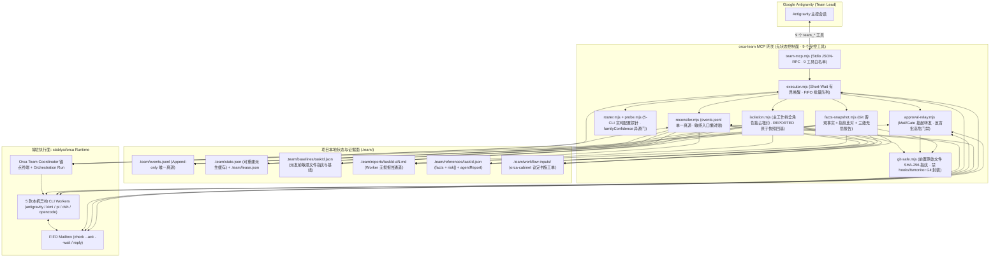

# `orca-team`：基于 `stablyai/orca` 的 Antigravity 受控工程团队协同网关设计方案（`v0.2` 内阁修订定稿版）

> **文档状态**：`v0.2` 内阁审议定稿版（已归档议定书 `.cabinet/runs/20261104-103944-orca-team-v01-arch/protocol.json`，`audit.ok: true`）  
> **审议阵容（4 异构 CLI × 4 模型家族）**：红队批判官「锋」（`antigravity` / `claude-opus-5-5-high`, `anthropic`）、架构官「远」（`kimi` / `k3.1-pro`, `moonshot`）、工程官「谋」（`pi` / `qwen3.8-max`, `qwen`）、成本官「众」（`dsh` / `deepseek-flash`, `deepseek`）  
> **对标前身**：`Git-Yi-Zhou/paseo-team`（借鉴 `waikoeng234/Nodo` 确定性编排理念与三栏上下文防火墙）  
> **协同生态**：与本机 `orca-cabinet` 组成**「前店（异构内阁议事定策）+ 后厂（工程团队受控施工）」**双插件闭环  
> **技术栈约束**：Node.js `>= 20` 纯内置模块（零外部 npm 依赖），基于 `orca` CLI（Supervised Orchestration + Terminal 原语）与加固版 Git 封装构建

---

## 1. `v0.1 → v0.2` 内阁审议核心修订对照表

经两轮独立立论与交叉质询（8/9 调用额度，0 重派，4/4 无损报告），内阁击穿了 `v0.1` 将 Paseo ACP 假设平移至 Orca 终端模式所产生的多项伪防线与高脆弱度桥接，达成 **9 项绑定工程裁决**：

| 维度 | `v0.1` 初稿设计 | 内阁红队/工程击穿点 | `v0.2` 终裁落地方案 |
| :--- | :--- | :--- | :--- |
| **1. 权限与安全边界** | `permission-guard.mjs` 宣称三通道挂起 +“阻断供应链注入”，轮询 `observation.agentWait` | Orca `worker-start` 拉起真实 CLI 终端，无逐工具事前拦截钩子；`agentWait === null` 不证明未挂起；无沙箱下仓库外写入与自动测试期命令已实际执行 | 拆分为 **`approval-relay.mjs`**（仅处理 `question`/`escalation` 邮件与 `gate`，删除 `agentWait` 探针）与 **`merge-gate`**（事后合并硬门禁）；诚实披露无 OS 沙箱残余风险 |
| **2. Git 合并门禁盲区** | 仅靠 `git diff` + `git status --porcelain` 扫描高危文件 | **红队「锋」致命击穿**：① `.git/config`、`.git/hooks/**`、`.git/info/attributes`、被 ignore 的 `.env*` 不进 `git diff/status`；② 注入 `.git/config` 的 `core.fsmonitor` 在网关自己跑 `git status` 瞬间即触发 RCE！ | **前置原始文件 SHA-256 指纹防线**：调**任何** `git` 命令前，用 Node `fs`+`crypto` 直读校验 `.git/config`、`.git/hooks/**`、`.git/info/*`、`.gitattributes`、`.env*`、`.npmrc`；且网关所有 `git` 调用强制前置 `-c core.hooksPath= -c core.fsmonitor=false` |
| **3. 工作区并发与隔离** | 写任务 `branch`/双路径 `worktree` 并发（含 `opencode` 外部 worktree 桥接），只读任务 `none` 自由并发 | 实机核验 Orca `v1.4.242` + OpenCode `v2.0.32` 拒绝 `--model`（`openCodeModelLaunchSupported !== true`）；只读角色无硬件锁，共享主树脏改无法归因且污染在途写分支 | 废除 `opencode --model` 与多写 worktree 桥接；实行**主工作树全角色统一独占租约（`TEAM_WORKSPACE_BUSY`）**，`team_delegate_batch` 采用主树租约下的有界 FIFO 串行推进，100% 零拷贝复用 `node_modules` 且污染 100% 单任务归因 |
| **4. `REPORTED` 锁释放与 `steer`** | 优先对在线终端 `orchestration send` 热续接，保留终端 | `worker-retain` 易留僵尸终端；若 `REPORTED` 不回基释放锁，后续 `review` 与下一任务将永久死锁 | **原子回基释放锁 + 冷启动 `steer`**：`REPORTED` 时立即 `worker-release`；写任务将未提交改动快照固化至 `team/<taskId>`（同时记录未跟踪残留与新增 ignored 产物），复核指纹后切回 `baseBranch` 并释放主树租约；`team_steer` 重检出 `team/<taskId>` 携客观 Diff 冷启 `attempt + 1` |
| **5. 5-CLI 真实路由表** | 混用大量失效的 `opencode --model alibaba-...` 条目 | 本机 5 款已就绪 CLI 真实能力为：`antigravity` 支持 `--model`/`--effort`，`kimi`/`pi`/`dsh`/`opencode` 走各自本地默认配置 | 基于本机实证的 **`antigravity` + `kimi` (`moonshot`) + `pi` (`qwen`) + `dsh` (`deepseek`) + `opencode` (默认兜底)** 重写 5 大角色三级降级链 |
| **6. 写审异源契约** | 按静态路由表跳过同家族，宣称“100% 物理异源” | 默认配置可能被用户中途修改，且 `team_steer` 可能触发跨家族降级产生多家族混合写分支 | 每次派发实时读取 CLI 本地配置，记录 `actualProviderFamily` + 三级 `familyConfidence`（`flag-verified` \| `config-inferred` \| `unknown`）；维护任务全量写 `attempt` 家族并集 `writerFamilies`，`reviewer` 跳过同族与 `unknown`，无候选即 **fail-closed** (`TEAM_CROSS_FAMILY_UNAVAILABLE`) |
| **7. 状态真源与对账频率** | 全部 9 工具入口无差别调 `orca check` + `worker-show` + `git branch` | 每次入口派生 3 个子进程造成 `300ms~1.5s` 阻塞，只读查询无需重对账 | `.team/events.jsonl` 为唯一真源，`.team/state.json` 为可随时重建的派生缓存；仅在 `board/delegate/delegate_batch/approve/steer/merge/interrupt` 执行懒对账，`inspect` 与 `from_protocol` 纯本地直读 |
| **8. 外部契约与议定书直通** | 9 工具面 + 读取 `.cabinet` | 需严格对齐 `orca-cabinet` 现产出的 `.cabinet/runs/<runKey>/protocol.json` 及 `.cabinet/index.jsonl` | 保留完整 **9 工具外部契约**；`team_from_protocol` 原生支持 `latest` 索引解析与 `schemaVersion === 2` 强校验 |
| **9. Windows 运行时与 TUI 加固** | 常规 `orca open` 管道调用、静态 `import` 配置 | Windows 下管道调 `orca open` 被 Electron 继承句柄永久挂起；`dsh-tui v0.16.1` 对大段粘贴停在 `draft` 待回车；杀 MCP 进程导致宿主断连 | `orca-exec.mjs` 采用 `detached: true, stdio: 'ignore'` 启动运行时 + 轮询 `orca status`；内置 **`dsh` `terminal.draft` 自动回车保护**；`team-roles.json` 按 `mtimeMs` 热读取 |

### 1.2 内阁审阅意见批判性解析：深度吸收加固项 vs. 纠偏不采纳项

为避免“机械照单全收角色人设下的极端主张”或“只抄结论漏掉根因细节”，我们对 4 席两轮共 8 份原始报告进行了逐条交叉推演，作出如下取舍与二次加固：

#### A. 深度吸收并补齐根因闭环的 6 项核心洞见
1. **可执行级篡改的「即时纯 Node 隔离中和」与「绝对不可合入」封锁**（吸收红队「锋」R2 对宿主 IDE 后台轮询秒级引爆 RCE 及 `.gitattributes` / `.vscode/tasks.json` 漏网向量的追问）：
   - **根因漏洞**：若检测到 `.git/config` (`core.fsmonitor`)、`.git/hooks/**`、`.gitattributes` (`filter.*` clean/smudge 驱动) 或 `.vscode/tasks.json` (`folderOpen` 自动任务) 被投毒后仅打标告警而将脏文件留在工作区等待后续 `discard`，宿主机 VS Code / Antigravity 每隔数秒自动后台裸跑的 `git status`（不带 `-c core.fsmonitor=false`）会在主控调 `discard` 之前直接触发 RCE！
   - **修正方案**：将受控敏感指纹细分为四类（`git_internal`、`git_filter_attr`、`ide_autorun`、`env_or_rc`）。一旦前三类可执行级载体异变，`settleWorkspaceAndReleaseLease` 在调用**任何** `git` 子进程前，立即由纯 Node `quarantineAndNeutralizeExecutableTamper()` 留存 `<=2KB` 取证片段（写入 `facts.quarantinedExecutableTamper`）并**当场还原洁净基线字节、删除新增恶意钩子/任务**；同时将该任务永久标记为 `hasUnmergeableExecutableTamper: true`，废除确认参数豁免——即使调用方同时传入 `acknowledgeRisks: true` 与 `acknowledgeCriticalTamper: true`，`team_merge(merge)` 与 `team_steer` 仍一律硬性拦截（`TEAM_EXECUTABLE_TAMPER_UNMERGEABLE`），唯一合法操作仅为 `discard`（仅对 `.env*` / `.npmrc` 保留双确认人工放行）。
2. **跨任务复用分支（`reuseBranchOfTaskId`）与多轮 `steer` 的根基线指纹继承**（吸收红队「锋」R2“基线快照若在变脏后重采会被洗白”的预判）：
   - **修正方案**：持久化 `rootBaselineTaskId`，在 `reuseBranchOfTaskId` 与 `team_steer` 检出既有任务分支后，**严禁**用检出后的分支文件状态覆盖比对基线，强制沿分支谱系继承最初在洁净 `baseBranch` 上采集的 `rootFingerprints`，确保前序回合或前序任务引入的 `.env*`/`.npmrc` 异变绝不被后续任务静默洗白。
3. **`t0/t1` 双端配置夹击校验（Config-Sandwich TOCTOU 防护）与真实 `~/.dsh` 探针**（吸收红队「锋」R1/R2 关于本地配置运行期漂移的批判）：
   - **修正方案**：修正 `~/.dsh` 探针，真实核查 `~/.dsh/profiles/dsh-tui/package.json` (`@deepseek-ai/dsh-base`)、`llm-deepseek` 与 `cordis.patch.yml` 自定义插件覆盖；对所有 `config-inferred` 类 CLI（`pi`/`kimi`/`dsh`/`opencode`），在派发前 `t0` 与 `REPORTED` 结算时 `t1` 双端鲜读配置。一旦运行期间模型或家族发生漂移，立即打标 `CONFIG_DRIFTED_DURING_RUN`，将 `familyConfidence` 降级为 `"unknown"` 并向 `writerFamilies` 注入 `"unknown"`，使后续异源审查自动按 fail-closed 阻断。
4. **分支谱系级（Branch-Lineage）`writerFamilies` 全量并集避让**（吸收架构官「远」R1 关于共享写分支跨任务传染的洞察）：
   - **修正方案**：`collectBranchLineageWriterFamilies()` 自动聚合目标任务及其共享 `team/<id>` 分支 / `reuseBranchOfTaskId` 链路上**全部写任务、全部 `attempt`** 的模型家族并集（如 `coder` 用 `qwen` 开发、`tester` 复用同一分支用 `deepseek` 补测，则 `reviewer` 自动同时排除 `qwen` 与 `deepseek`），并在审查报告中显式输出 `reviewIndependenceGrade`（`flag-verified-strong` | `config-inferred-sandwich` | `unverified`）。
5. **网关快照透明记账与崩溃残片显式预警**（调和「锋/远」与「谋/众」关于未提交改动自动快照的争鸣）：
   - **修正方案**：保留 `REPORTED` 自动快照回基以保障主树洁净，但新增 `facts.gatewaySnapshot`（记录 `{ autoCommitted, autoCommittedFiles, workerCommittedPrior }`）；当 Worker 异常退出（`workerExitError`）且存在被网关代为快照的未提交文件时，自动打上 `PARTIAL_UNCOMMITTED_ON_ERROR` 风险标签，杜绝崩溃半成品伪装成正常交付。
6. **空闲态零子进程对账短路与消除空队列重复对账**（吸收工程官「谋」R1/R2 性能优化建议）：
   - **修正方案**：无活跃任务时 `reconcileWorkspace` 直接零 `orca` 子进程短路返回；`git branch --list 'team/*'` 孤儿分支扫描收敛至 `team_board` 与 `team_merge` 按需执行；`waitForTasksProgress` 仅在确实存在 `QUEUED` 批量任务时才触发推进与二次对账。

#### B. 经工程推演予以批判性纠偏、明确不采纳的 3 项极端主张
1. **拒斥「锋、远」R2 提出的“写任务持主树租约直至 `MERGED/DISCARDED` 才释放”**：
   - **纠偏理由**：在四席一致赞同「主工作树全角色统一独占租约」的前提下，若写任务到达 `REPORTED` 后仍死握 `.team/lease.json` 不回基释放，主控在合入前按规程调用 `team_delegate(type: "review")` 将 100% 触发 `TEAM_WORKSPACE_BUSY`——直接制造**“合入前必须异源审查 vs. 未合入绝不释放主树锁”的 100% 逻辑死锁**。采用「谋、众」的 `REPORTED` 原子快照回基释放锁，叠加 `gatewaySnapshot` 与 `IGNORED_ARTIFACTS_LEFT` 留痕，才是无死锁且零归因丢失的工程正解。
2. **拒斥「锋」R2 提出的“一刀切封杀所有 `config-inferred` CLI 担任 `reviewer`（仅准许 `antigravity`）”**：
   - **纠偏理由**：将 `reviewer` 唯一绑定于 `antigravity` 会制造严重的单点故障（SPOF），一旦 `antigravity` 配额受限或网络抖动，全流程审查即告瘫痪。通过将 `antigravity` (`flag-verified`) 排在 `reviewer` 候选链首位，同时对备选 `dsh`/`kimi` 施加 `t0/t1` 双端配置夹击校验与 `reviewIndependenceGrade` 明文披露，兼顾了高可信度与高可用韧性。
3. **拒斥「众」“彻底删除 `.team/state.json`”与「谋（R1）」“砍掉 `steer`/`delegate_batch`/`from_protocol` 缩减为 6 工具”**：
   - **纠偏理由**：完整 9 工具闭环与 `orca-cabinet` 议定书一键承接是核心架构契约；将 `state.json` 严格实现为带 `eventCount` 强校验的自愈派生缓存（损坏或删除后零报错从 `events.jsonl` 自动重放重建），既消除了双真源漂移，又保住了 `team_inspect` 的 O(1) 纯本地读取性能。

---

## 2. 系统总体架构与安全边界声明

### 2.1 总体架构图（`v0.2`）



### 2.2 诚实安全边界声明（Honest Security Model）

1. **已构建的确定性硬防线**：
   - **网关自身免疫 Git 钩子/监控器注入**：`orca-team` 发起的每一条 `git` 命令均通过 `execGitSafe()` 强制携带 `-c core.hooksPath= -c core.fsmonitor=false` 与 `GIT_TERMINAL_PROMPT=0`，即使 `.git/config` 被恶意写入 `core.fsmonitor` 亦无法在网关进程触发执行。
   - **前置原始文件 SHA-256 指纹门禁**：在获取主树租约时（Worker 启动前）及回收/审批/合入时（调任何 `git` 命令前），使用纯 Node `fs` + `crypto` 对 `.git/config`、`.git/hooks/**`、`.git/info/attributes`、`.git/info/exclude`、`.gitattributes`、`.env*`、`.npmrc`、`.yarnrc*` 计算原始字节 SHA-256 指纹。一旦异变立即打标 `CRITICAL_GIT_OR_ENV_TAMPERED`，硬性阻断静默合入；若丢弃任务（`discard` / `interrupt`），自动从基线备份恢复 `.git/config` 与清理新增恶意钩子，防止给宿主人类开发者的后续手动 `git` 命令留雷。
   - **主分支（`baseBranch`）零直接污染与防漂移合入**：写任务一律在 `team/<taskId>` 分支执行，`REPORTED` 快照固化后原子切回 `baseBranch`；合入前强校验 `baseBranch` 当前 `HEAD === baseSha`、高危文件确认与风险显式确认。
   - **三栏上下文防火墙**：严格隔离客观 `facts`、零 Token 规则 `risk[]` 与不可信主观自述 `agentReport` (`trustLevel: "untrusted-self-report"`)。
2. **明文披露的无 OS 沙箱残余风险（不作虚假承诺）**：
   - Orca `worker-start` 运行在宿主机当前用户权限下的真实 CLI 终端中，未挂载容器或 OS 级文件系统命名空间沙箱；
   - 若某个 CLI 在用户自身的全局自动执行设置下，于任务运行期间直接读写了**仓库目录之外**的路径（例如 `~/.bashrc`、`~/.npmrc`）或在跑测试时发起了出网请求，网关无法作**事前拦截**（`approval-relay` 仅转发 Worker 主动发出的 Orca `question`/`escalation` 邮件与 `decision_gate`）。

---

## 3. 本机 5-CLI 异构角色路由与证据分级异源契约

### 3.1 CLI 能力矩阵与实时家族推断等级

| CLI 标识 | `--model` 传参 | `--effort` 传参 | 模型/家族实时发现机制（派发时鲜读） | `familyConfidence` 等级 |
| :--- | :---: | :---: | :--- | :--- |
| **`antigravity`** | 支持 | 支持 | 命令行显式固定 `--model=<id>` | **`flag-verified`**（强参数级） |
| **`kimi`** | 不支持 | 不支持 | 实时解析 `~/.kimi-code/config.toml` (`default_model`) | **`config-inferred`**（配置推断级） |
| **`pi`** | 不支持 | 不支持 | 实时解析 `~/.pi/agent/settings.json` (`defaultProvider` + `defaultModel`) | **`config-inferred`**（配置推断级） |
| **`dsh`** | 不支持 | 不支持 | 检测 `~/.dsh` 与 DeepSeek 官方 TUI 默认绑定 (`deepseek-flash`) | **`config-inferred`**（配置推断级） |
| **`opencode`** | 不支持（v2.0.32） | 不支持 | 实时解析 `opencode.json` 或 `~/.local/state/opencode/model.json` | **`config-inferred`**（配置推断级） |

> 若任一非传参 CLI 的本地配置文件缺失或无法映射已知模型家族，一律记为 `actualProviderFamily: "unknown", familyConfidence: "unknown"`。

### 3.2 5 大工程角色三级自动降级链（`config/team-roles.json`）

每个角色的三级候选均跨越 **至少 3 个不同模型家族**，确保单点断网/限流时无缝降级，且为 `reviewer` 留足异源空间：

| 角色 ID (`roleId`) | 模式 | 档位 | 首选 (`primary`) | 一级降级 (`fallback1`) | 二级降级 (`fallback2`) | 兜底 (`fallback3`) |
| :--- | :---: | :---: | :--- | :--- | :--- | :--- |
| **`architect`** | `readonly` | `normal` | `pi` (`qwen`) | `kimi` (`moonshot`) | `antigravity` / `gpt-oss-120b-medium` (`openai-oss`) | — |
| **`architect`** | `readonly` | `hard` | `kimi` (`moonshot`) | `antigravity` / `claude-opus-5-5-high` (`anthropic`) | `pi` (`qwen`) | — |
| **`coder-fast`** | `write` | `normal` | `pi` (`qwen`) | `antigravity` / `claude-sonnet-5-5-high` (`anthropic`) | `dsh` (`deepseek`) | `opencode` (`deepseek`) |
| **`coder-pro`** | `write` | `hard` | `antigravity` / `claude-opus-5-5-high` (`anthropic`) | `kimi` (`moonshot`) | `pi` (`qwen`) | — |
| **`reviewer`** | `readonly` | `normal` | `antigravity` / `gpt-oss-120b-medium` (`openai-oss`, `flag-verified`) | `dsh` (`deepseek`) | `kimi` (`moonshot`) | `antigravity` / `claude-sonnet-5-5-high` (`anthropic`, `flag-verified`) |
| **`reviewer`** | `readonly` | `hard` | `antigravity` / `claude-sonnet-5-5-high` (`anthropic`, `flag-verified`) | `antigravity` / `gpt-oss-120b-medium` (`openai-oss`, `flag-verified`) | `kimi` (`moonshot`) | `dsh` (`deepseek`) |
| **`tester`** | `write` | `normal` | `dsh` (`deepseek`) | `antigravity` / `gpt-oss-120b-medium` (`openai-oss`) | `pi` (`qwen`) | — |
| **`tester`** | `write` | `hard` | `antigravity` / `claude-sonnet-5-5-high` (`anthropic`) | `kimi` (`moonshot`) | `dsh` (`deepseek`) | — |

### 3.3 写审异源避让铁律（Fail-Closed）

1. 每个写任务在生命周期内维护 `writerFamilies: string[]`（记录初始 `team_delegate` 及历次 `team_steer` 实际派发的所有 `actualProviderFamily` 并集）与 `attempts[]` 明细。
2. 当调用 `team_delegate({ type: "review", targetTaskId })` 时：
   - 若目标任务 `writerFamilies` 为空或包含 `"unknown"`，无法证明异源独立性，网关直接 **fail-closed** 拒绝派发并返回错误码 `TEAM_CROSS_FAMILY_UNAVAILABLE`；
   - 遍历 `reviewer` 候选链，自动跳过 `actualProviderFamily === "unknown"` 或命中 `writerFamilies` 的候选；
   - 若过滤后无就绪异源候选，同样 **fail-closed** 返回 `TEAM_CROSS_FAMILY_UNAVAILABLE`，绝不静默退化为同源互审。

---

## 4. 主工作树统一独占租约与生命周期状态机

### 4.1 状态流转定义

```text
QUEUED (批量队列待调度)
  └─> PENDING (校验干净树、捕获前置原始指纹与 baseSha、获取主树租约 .team/lease.json)
        └─> RUNNING (已拉起 Orca Worker 终端，绑定 dispatchId)
              ├─> AWAITING_APPROVAL (收到 Orca question / escalation 邮件或未决 gate)
              │     └─> RUNNING (team_approve 放行或驳回后继续运行)
              ├─> REPORTED (Worker 结束 -> 立即 worker-release -> 校验原始指纹 -> 固化分支快照 -> 原子切回 baseBranch -> 释放主树租约)
              │     ├─> RUNNING (team_steer 重检出 team/<taskId> 携客观 Diff 冷启 attempt + 1)
              │     ├─> MERGED (team_merge 校验指纹 + baseSha 未漂移 + 风险确认 -> 合入 baseBranch 并删除 team/<taskId>)
              │     └─> DISCARDED (team_merge discard -> 删除 team/<taskId>，必要时恢复 .git 基线)
              ├─> ABORTED (team_interrupt 终止 Worker，按需删除分支并释放主树租约)
              └─> ORPHANED (Worker 进程/分支意外失联，保留现场供人工或主控审计，不静默删代码)
```

### 4.2 应对内阁少数派保留意见（Dissent）的定向工程加固

1. **针对「锋、远」关于 `REPORTED` 切回 `baseBranch` 时 `gitignored` 构建产物残留的保留意见**：
   - 派发前记录 `git status --ignored --porcelain=v1` 基线；`REPORTED` 切回 `baseBranch` 前比对新增的被忽略路径（排除 `.team/`、`.cabinet/`、`node_modules/`），一旦存在新增被忽略产物，记入 `facts.ignoredArtifacts` 并打上确定性提示标签 `IGNORED_ARTIFACTS_LEFT`，让主控在审查与合入时一目了然。
2. **针对「锋」关于 `config-inferred` 仅属配置级推断而非运行态物理回执的保留意见**：
   - 在 `reviewer` 常规档与攻坚档的首选/高优顺位均内置 `antigravity`（`gpt-oss-120b-medium` `openai-oss` 与 `claude-sonnet-5-5-high` `anthropic`），优先提供 `familyConfidence: "flag-verified"` 级别的强异源证明，并在 `.team/references/<taskId>.json` 中如实披露每次 attempt 的 `familyConfidence`。
3. **针对「众」关于极简状态层的保留意见**：
   - 确立 `.team/events.jsonl` 为唯一真源；`.team/state.json` 严格限制为纯派生快照（若文件缺失或 JSON 损坏，网关零报错自动从 `events.jsonl` 内存重放重建）。

---

## 5. 9 个受控 MCP 工具面与风险标签字典

### 5.1 9 工具契约清单
1. `team_board`：查看 5 角色实时路由表与 CLI 探针状态、主树租约状态、孤儿分支告警及全部任务列表；或传入 `taskId` + `waitSeconds` 有界等待单任务进展。
2. `team_delegate`：按 `(type, hard)` 确定性派发单任务（含幂等键 `idempotencyKey` 去重、主树租约获取、前置指纹基线与有界短等待）。
3. `team_delegate_batch`：校验并登记最多 4 个子任务，在主树独占租约下按 FIFO 自动串联推进与有界等待。
4. `team_approve`：转发处理 Orca `question`/`escalation` 邮件与 `decision_gate`；`allow` 前强校验原始文件指纹与高危文件 Diff（反盲批护栏）。
5. `team_steer`：对 `REPORTED` 任务重新获取主树租约、检出 `team/<taskId>`，注入前序客观 `diffStat` 与前序报告摘要，冷启动 `attempt + 1`（若任务仍在 `RUNNING`，亦可通过 Orca 邮箱追加指导消息）。
6. `team_inspect`：纯本地零对账延迟深钻 `.team/references/<taskId>.json`、全量 `git diff` 及可选终端尾部日志。
7. `team_interrupt`：终止在途 Worker、释放终端与主树租约，可选 `discardBranch: true` 清理分支并恢复基线。
8. `team_merge`：`merge`（支持 `no-ff` / `squash` / `cherry-pick`）或 `discard`；合入前执行前置原始指纹复核、`baseSha` 漂移检查与 `risk[]` 显式确认门禁。
9. `team_from_protocol`：直读 `.cabinet/runs/<runKey>/protocol.json`（支持 `"latest"` 自动解析 `.cabinet/index.jsonl`），校验 `schemaVersion === 2`，生成 `.team/workflow-inputs/protocol-<runKey>.md` 与待派发结构化施工草案。

### 5.2 确定性风险标签字典（`risk[]`）
- `CRITICAL_GIT_OR_ENV_TAMPERED`：（最高危）原始 SHA-256 指纹检测到 `.git/config`、`.git/hooks/**`、`.git/info/*`、`.gitattributes`、`.vscode/{tasks,settings}.json`、`.env*`、`.npmrc` 或 `.yarnrc*` 被篡改/新增/删除。其中前三类可执行级篡改在 `REPORTED` 瞬间即由纯 Node 隔离还原并标记 `hasUnmergeableExecutableTamper: true`（永久禁止 `merge`，仅允许 `discard`）。
- `HIGH_RISK_FILE_MODIFIED`：改动命中 `package.json`、lockfile、CI 工作流、IDE 配置（`.vscode/**` / `.idea/**`）、构建脚本等高危路径。
- `CONFIG_DRIFTED_DURING_RUN`：`config-inferred` 类 CLI 在派发前 `t0` 与结算时 `t1` 的本地模型/家族配置发生运行期漂移，`familyConfidence` 自动降级为 `"unknown"` 并阻断异源审查盲信。
- `PARTIAL_UNCOMMITTED_ON_ERROR`：Worker 非正常报错退出且工作树遗留未提交半成品文件（已由网关快照至任务分支供 `team_inspect` 取证，严禁盲目合入）。
- `READONLY_ROLE_DIRTIED_TREE`：只读角色（`architect` / `reviewer`）违规修改、新建文件或提交代码（已自动取证并硬重置恢复洁净）。
- `UNTRACKED_ARTIFACTS_LEFT`：Worker 遗留临时/调试未跟踪文件，或在自行 commit 后仍残留未跟踪文件。
- `IGNORED_ARTIFACTS_LEFT`：Worker 运行后新增了 `.gitignore` 覆盖的构建/缓存产物（切回 `baseBranch` 时仍驻留工作树）。
- `NO_EFFECTIVE_DIFF`：写角色（`coder-*` / `tester`）完成后相对于 `baseSha` 无任何有效代码变更。
- `WORKER_EXIT_WITH_ERROR`：Orca Worker 非正常失败退出或汇报 `worker_blocked`。

---

## 6. 目录结构与验证门禁

```text
orca-team/
├── plugin.json                  # Antigravity 插件清单（严格遵循 7 字段白名单）
├── mcp_config.json              # 注册 "team" MCP 服务 -> node ./server/team-mcp.mjs
├── hooks.json                   # PreToolUse 极速守卫（主树持锁期间防裸调冲突工具）
├── package.json                 # Node >= 20, type: module, 零外部依赖
├── assets/logo.svg              # 插件矢量图标
├── config/team-roles.json       # 5 角色路由链、5-CLI 能力表、指纹与高危文件规则（mtime 热加载）
├── docs/
│   ├── 设计方案-v0.1.md
│   └── 设计方案-v0.2-内阁修订版.md
├── rules/AGENTS.md              # Team Lead 四大工程协同铁律
├── skills/team-workflow/SKILL.md# 日常研发闭环 + 内阁议定书落地 SOP
├── server/
│   ├── team-mcp.mjs             # 零依赖 Stdio JSON-RPC 2.0 服务器（双帧兼容）
│   └── lib/
│       ├── git-safe.mjs         # 前置原始 SHA-256 指纹采集比对 + 禁 hooks/fsmonitor Git 封装
│       ├── orca-exec.mjs        # Orca 解耦启动、Coordinator 锚点、Worker 管理与 dsh 自动回车
│       ├── probe.mjs            # 5min 探针缓存 + 派发时 CLI 本地配置鲜读与家族置信度分级
│       ├── router.mjs           # (type, hard) 路由、三级降级与 writerFamilies 异源 fail-closed
│       ├── facts-snapshot.mjs   # 三栏防火墙快照计算与三级无损报告回收
│       ├── isolation.mjs        # 主工作树独占租约、原子快照回基与防漂移合入/回滚
│       ├── approval-relay.mjs   # Orca Mail/Gate 挂起解析转发与反盲批门禁
│       ├── reconciler.mjs       # events.jsonl 真源、state.json 重建缓存与敏感入口懒对账
│       └── executor.mjs         # 9 工具编排器、FIFO 批量队列与 Short-Wait 控制器
├── scripts/
│   ├── link-plugin.mjs          # 注册 ~/.gemini/config/plugins.json + Windows Junction
│   ├── hook-guard.mjs           # <2ms 快速路径主树租约防干扰守卫
│   └── audit.mjs                # 离线 .team/ 事件账本、租约健康度与孤儿分支审计器
└── tests/
    ├── verify.mjs               # 清单白名单、语法检查、9 工具 Schema 与多家族降级链静态门禁
    └── smoke.mjs                # 真实临时 Git 仓 + 可控 Mock Orca 正向全闭环 + >=8 条负向故障注入
```
